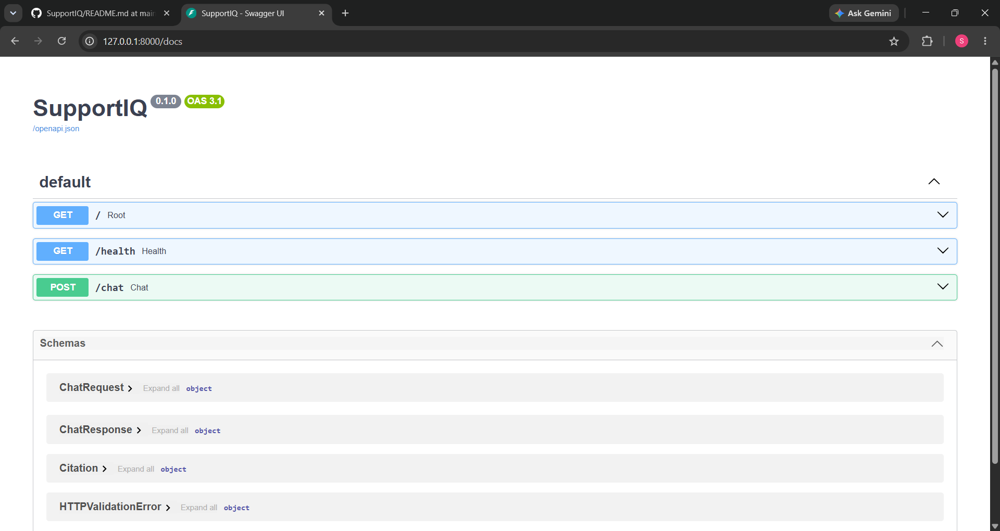
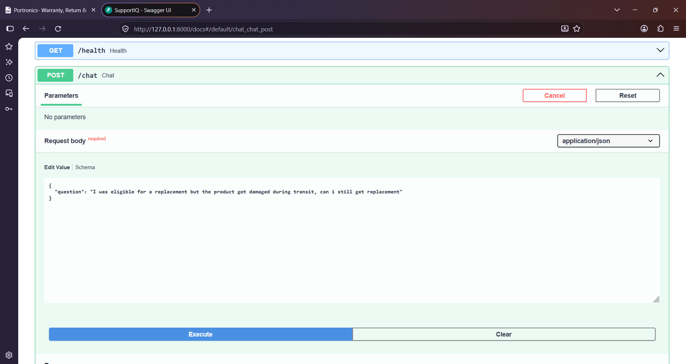
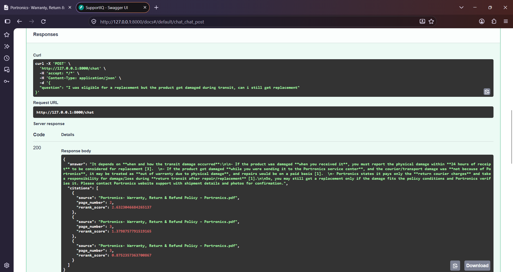

# SupportIQ — RAG-Powered Customer Support Assistant

SupportIQ is a Retrieval-Augmented Generation (RAG) based customer-support assistant that answers user questions using information retrieved from policy documents. It combines semantic search, keyword-based retrieval, hybrid ranking, and Cross-Encoder reranking to provide relevant, context-grounded answers with source citations.

## Demo

### API Documentation — Swagger UI

Run the application locally and access the interactive API documentation at:

`http://127.0.0.1:8000/docs`

### Screenshots

### Screenshots

#### API Documentation


#### Chat Request


#### Generated Response with Citations



## Features

- **PDF Ingestion:** Extracts document text and preserves source and page metadata using PyMuPDF.
- **Recursive Text Chunking:** Splits documents into manageable, overlapping chunks using LangChain text splitters.
- **Semantic Search:** Uses Sentence Transformers embeddings and ChromaDB for semantic retrieval.
- **Keyword Search:** Implements BM25 to retrieve documents based on important query terms.
- **Hybrid Search:** Combines semantic and keyword retrieval using Reciprocal Rank Fusion (RRF).
- **Cross-Encoder Reranking:** Re-evaluates retrieved query-document pairs to improve relevance ordering.
- **Grounded Answer Generation:** Uses the OpenAI API to generate answers based on retrieved policy evidence.
- **Source Citations:** Returns source document and page references alongside generated answers.
- **Fallback Handling:** Handles questions for which the available policy evidence is insufficient.
- **REST API:** Exposes the RAG pipeline through FastAPI with interactive Swagger documentation.
- **Testing:** Uses pytest to validate individual components and retrieval functionality.

## Architecture

```text
                 Policy PDF
                     |
                     v
              Document Loader
                  (PyMuPDF)
                     |
                     v
             Recursive Chunking
                  (LangChain)
                     |
                     v
             Hugging Face Embeddings
                     |
                     v
                 ChromaDB
                     |
                     |
              Customer Query
                     |
             +-------+-------+
             |               |
             v               v
        Vector Search      BM25 Search
             |               |
             +-------+-------+
                     |
                     v
             Reciprocal Rank
                 Fusion
                   (RRF)
                     |
                     v
              Cross-Encoder
                Reranking
                     |
                     v
              Top Relevant
                  Chunks
                     |
                     v
             OpenAI Answer
                Generation
                     |
                     v
             Answer + Citations
                     |
                     v
                 FastAPI
```

## How It Works

1. Extract text and page metadata from the configured policy PDF.
2. Split the extracted text into overlapping chunks.
3. Generate embeddings and store document chunks in ChromaDB.
4. Receive a customer query.
5. Retrieve relevant candidates through semantic search and BM25 keyword search.
6. Combine the retrieval rankings using Reciprocal Rank Fusion.
7. Rerank the hybrid candidates using a Cross-Encoder model.
8. Select the highest-ranked chunks and pass them to the answer generator.
9. Generate a context-grounded response and return it with source citations through FastAPI.

## Tech Stack

| Component            | Technology                     |
| -------------------- | ------------------------------ |
| Programming Language | Python                         |
| Backend Framework    | FastAPI                        |
| RAG Framework        | LangChain                      |
| PDF Processing       | PyMuPDF                        |
| Text Chunking        | RecursiveCharacterTextSplitter |
| Embedding Model      | all-MiniLM-L6-v2               |
| Vector Database      | ChromaDB                       |
| Keyword Retrieval    | BM25                           |
| Hybrid Ranking       | Reciprocal Rank Fusion (RRF)   |
| Reranking            | Cross-Encoder                  |
| LLM                  | OpenAI API                     |
| Data Validation      | Pydantic                       |
| Testing              | pytest                         |

## Project Structure

```text
SupportIQ/
│
├── app/
│   ├── main.py
│   │
│   ├── services/
│   │   ├── document_loader.py
│   │   ├── chunker.py
│   │   ├── embeddings.py
│   │   ├── vector_store.py
│   │   ├── retriever.py
│   │   ├── bm25_retriever.py
│   │   ├── hybrid_retriever.py
│   │   ├── reranker.py
│   │   └── answer_generator.py
│   │
│   └── data/
│       └── policies/
│
├── tests/
│
├── chroma_db/
│
├── requirements.txt
├── .env.example
├── .gitignore
└── README.md
```

The `chroma_db/` directory is generated locally and should not be committed to Git.

## Setup and Installation

### 1. Clone the repository

```bash
git clone https://github.com/Sudhansu12349/SupportIQ.git
cd SupportIQ
```

### 2. Create a virtual environment

```bash
python -m venv .venv
```

Activate it on Windows CMD:

```cmd
.venv\Scripts\activate
```

### 3. Install dependencies

```bash
python -m pip install -r requirements.txt
```

### 4. Configure environment variables

Create your local `.env` file using `.env.example` as a template.

```cmd
copy .env.example .env
```

Add your own OpenAI API key and configure the model if required.

**Never commit your `.env` file or expose API keys publicly.**

### 5. Add your policy document

Place your policy PDF at the configured location:

```text
app/data/policies/
```

The currently configured Portronics policy PDF is not distributed with this repository. Use a document you are authorized to process.

### 6. Run the application

From the project root:

```bash
uvicorn app.main:app --reload
```

Open:

`http://127.0.0.1:8000/docs`

## API Usage

### Endpoint

`POST /chat`

### Example Request

```json
{
  "question": "What happens if my product develops a manufacturing defect?"
}
```

The API returns a generated answer and source citations containing document references and page information.

## Testing

Run the automated test suite:

```bash
python -m pytest -v
```

The project includes tests for document processing, retrieval components, vector storage, BM25, hybrid ranking, and other core functionality.

Manual beta testing has also been performed using questions based on the configured policy document.

## Current Limitations

- The current implementation uses a configured policy document rather than a complete multi-document knowledge management system.
- Retrieval quality has undergone initial manual beta testing; systematic evaluation using Recall\@K, Precision\@K and MRR is planned.
- Document update, deletion, and duplicate-ingestion handling need further improvement.
- Authentication, persistent conversation history, and production deployment are not yet implemented.
- The frontend interface is planned for a future development phase.

## Roadmap

- [x] PDF ingestion and text chunking
- [x] Semantic retrieval using embeddings and ChromaDB
- [x] BM25 keyword retrieval
- [x] Hybrid search using Reciprocal Rank Fusion
- [x] Cross-Encoder reranking
- [x] Grounded answer generation with citations
- [x] FastAPI integration
- [x] Initial manual beta testing
- [ ] Retrieval evaluation and optimization
- [ ] Improved document ingestion and management
- [ ] PostgreSQL integration
- [ ] Redis caching
- [ ] React frontend
- [ ] Authentication and conversation history
- [ ] Deployment and production testing

## Project Status

**Core RAG backend implemented and manually beta-tested.**

The next development phase focuses on evaluation, backend improvements, frontend development, and deployment.

---

**Built with Python, FastAPI, LangChain, ChromaDB, Hugging Face, and OpenAI.**
